<div align="center">

# 🚀 JobSphere — Full-Stack Job Portal & Management System

<p align="center">
  <strong>A modern, enterprise-ready recruitment platform connecting top talent with industry-leading companies.</strong>
</p>

[](https://spring.io/projects/spring-boot)
[](https://react.dev/)
[](https://openjdk.org/)
[](https://www.mysql.com/)
[](https://jwt.io/)
[](https://mui.com/)
[](LICENSE)

<br/>

[Key Features](#-key-features) •
[UI Showcase](#-ui-showcase) •
[Tech Stack](#-tech-stack) •
[System Architecture](#-system-architecture) •
[Quick Start](#-quick-start-guide) •
[API Reference](#-api-endpoints-reference) •
[Default Credentials](#-default-credentials)

---

</div>

## 🌟 Overview

**JobSphere** is an end-to-end Job Portal & Recruitment Management System engineered with **Spring Boot 3.2 (Java 21)** on the backend and **React 18** on the frontend. It delivers a fast, responsive, and secure experience for both job seekers looking for their dream roles and hiring managers seeking streamlined applicant tracking, job publishing, and real-time candidate management.

---

## ✨ Key Features

<table>
<tr>
<td width="50%" valign="top">

### 👨‍💻 Candidate Portal
* **Live Job Search & Filters:** Real-time keyword search across roles, technologies, experience levels, and locations.
* **1-Click Application:** Frictionless application process linked directly to applicant profile and resume details.
* **Saved Jobs:** Bookmark opportunities to review and apply anytime.
* **Interactive Kanban Board:** Visualize application progress (*Applied*, *In Review*, *Shortlisted*, *Interview*, *Offered*, *Rejected*).
* **Automated Email Notifications:** Instant confirmation upon successful job application.
* **Career Resources & Guides:** Curated interview prep, resume checklists, and salary trends.

</td>
<td width="50%" valign="top">

### 💼 Recruiter & Admin Suite
* **Multi-Step Job Publisher:** 4-step guided wizard for creating structured job listings with tech stack tags and salary benchmarks.
* **Full CRUD Operations:** Edit, publish, pause, or remove job listings instantly.
* **Application Tracking System (ATS):** Review applicant submissions, contact information, and attached credentials.
* **Status Pipeline Control:** Move candidates between evaluation stages with a single click.
* **Role-Based Access Control (RBAC):** Strict JWT-authenticated route guards protecting admin management endpoints.
* **Seed Data Auto-Initialization:** Ready-to-demo data loaded automatically on first boot.

</td>
</tr>
</table>

---

## 📸 UI Showcase

<div align="center">

### 🏠 Landing Page & Hero Section
*Hero with live search counters, featured category badges, and quick filters.*
<br/>
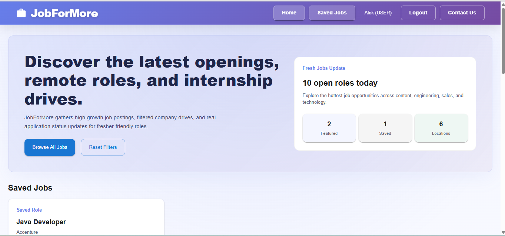

<br/><br/>

### 📊 Dashboards: Candidate vs Admin Recruiter
<table>
  <tr>
    <td align="center" width="50%"><strong>👤 Candidate Dashboard & Saved Jobs</strong></td>
    <td align="center" width="50%"><strong>👨‍💼 Recruiter Admin Management Portal</strong></td>
  </tr>
  <tr>
    <td>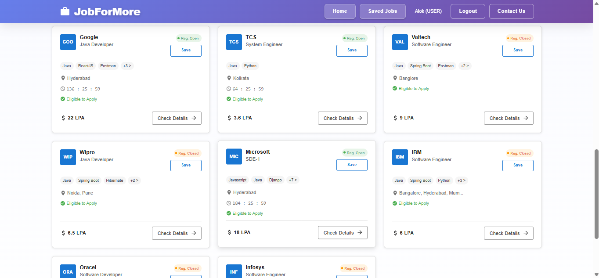</td>
    <td>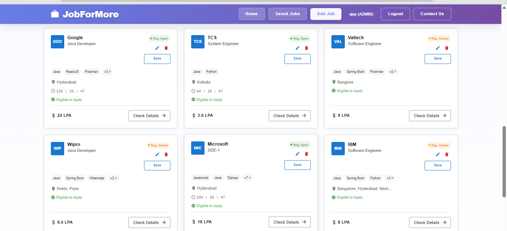</td>
  </tr>
</table>

<br/>

### 🔐 Authentication Flow
<table>
  <tr>
    <td align="center" width="50%"><strong>Login Screen</strong></td>
    <td align="center" width="50%"><strong>Registration Screen</strong></td>
  </tr>
  <tr>
    <td>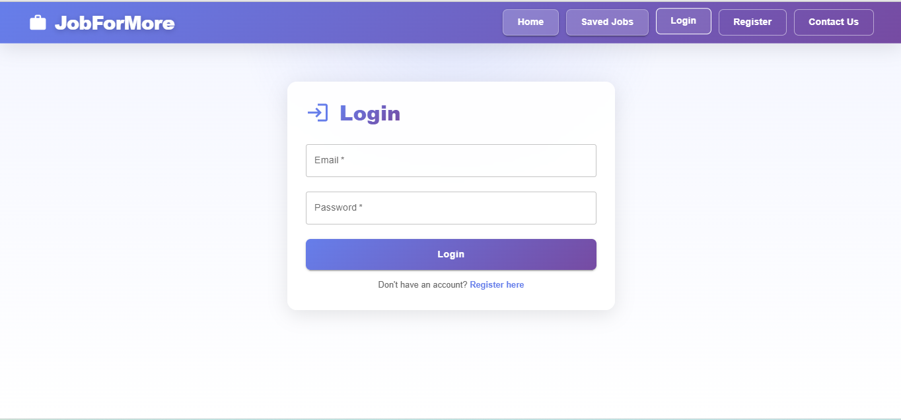</td>
    <td>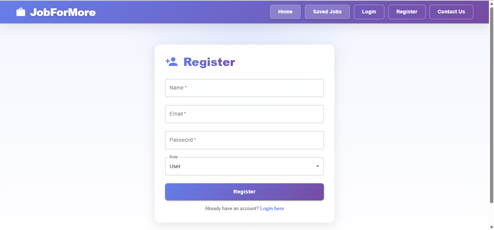</td>
  </tr>
</table>

<br/>

### ➕ Multi-Step Job Creation Wizard (Admin)
<table>
  <tr>
    <td align="center" width="50%"><strong>Step 1: Role Overview & Basic Details</strong></td>
    <td align="center" width="50%"><strong>Step 2: Tech Stack & Skill Tags</strong></td>
  </tr>
  <tr>
    <td>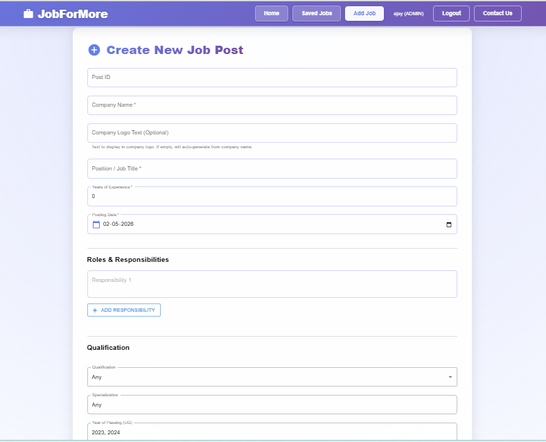</td>
    <td>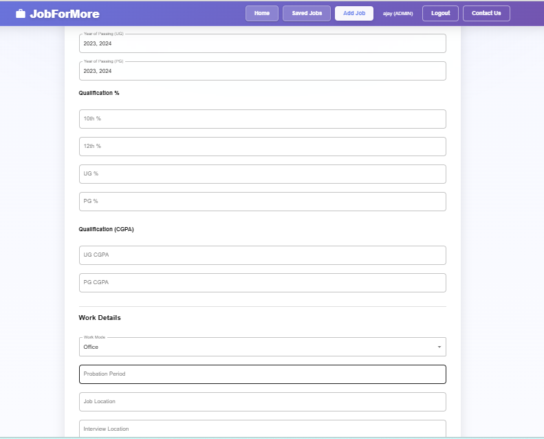</td>
  </tr>
  <tr>
    <td align="center"><strong>Step 3: Experience & Compensation</strong></td>
    <td align="center"><strong>Step 4: Final Review & Publishing</strong></td>
  </tr>
  <tr>
    <td>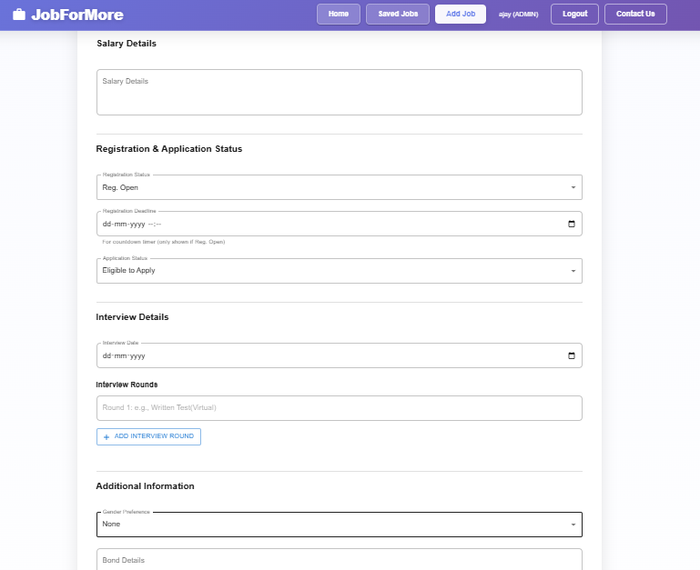</td>
    <td>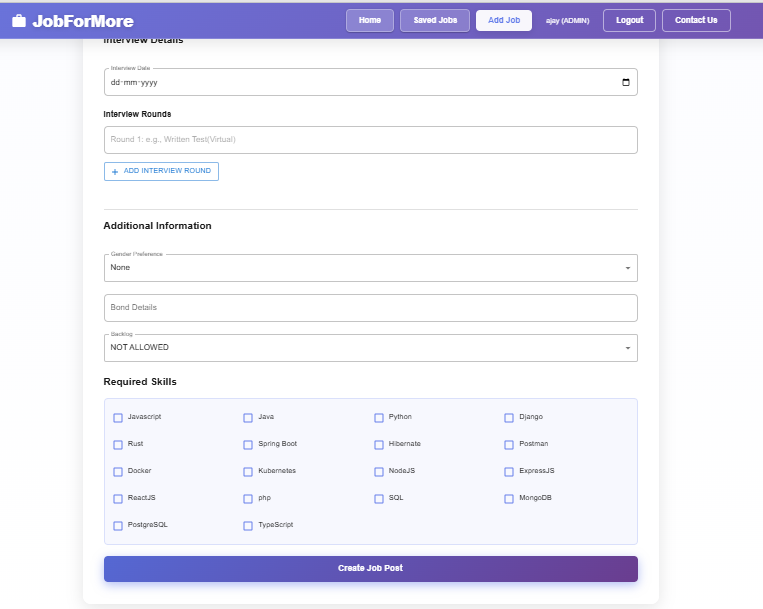</td>
  </tr>
</table>

<br/>

### 💾 Job Bookmarking & Email Confirmation
<table>
  <tr>
    <td align="center" width="50%"><strong>Saved Jobs Drawer</strong></td>
    <td align="center" width="50%"><strong>Automated Email Dispatch</strong></td>
  </tr>
  <tr>
    <td>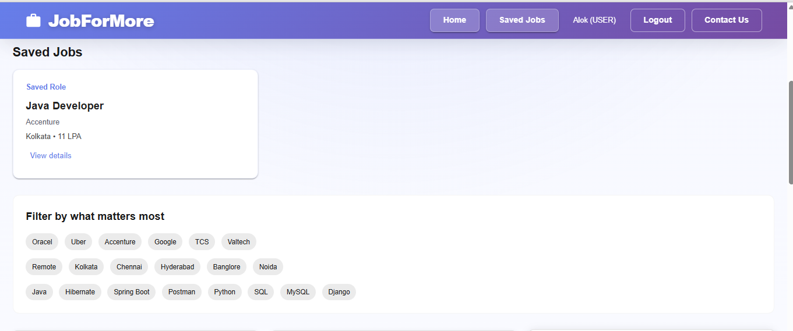</td>
    <td>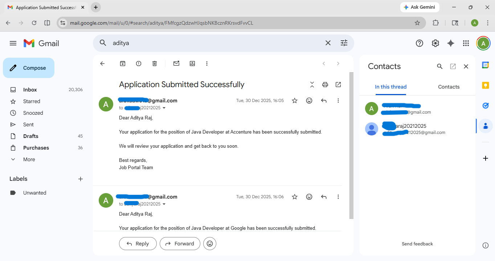</td>
  </tr>
</table>

</div>

---

## 🛠️ Tech Stack

<div align="center">

| Layer | Technologies & Libraries |
| :--- | :--- |
| **Backend Framework** | **Java 21**, **Spring Boot 3.2.12**, Spring Web MVC, Spring Security |
| **Data Persistence** | **MySQL 8.0+**, Spring Data JPA, Hibernate ORM |
| **Security & Auth** | **JWT (JSON Web Token)**, BCrypt Password Hashing, RBAC Filters |
| **Mail Services** | **Spring Boot Starter Mail** (JavaMailSender / Gmail SMTP) |
| **Frontend Core** | **React 18.2**, Vanilla JavaScript (ES6+), React Context API |
| **UI Components** | **Material-UI (MUI 5)**, Material Icons, Custom CSS3 Design System |
| **Routing & HTTP** | **React Router DOM v6**, **Axios** with Bearer Token Interceptors |
| **Build & Tooling** | **Maven Wrapper (`./mvnw`)**, **npm**, Postman, Git |

</div>

---

## 🏗️ System Architecture

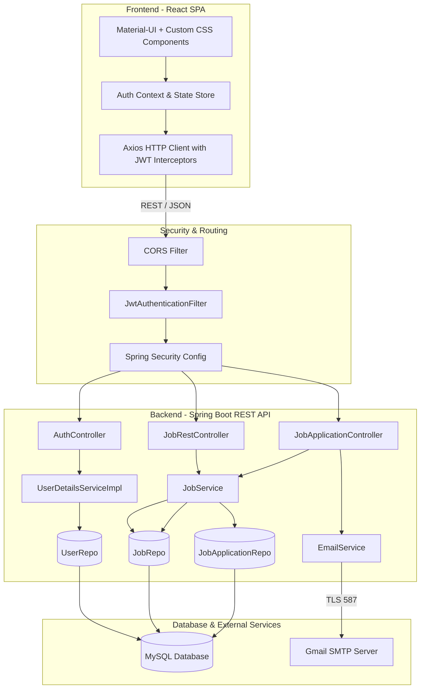

---

## 📋 Prerequisites

Before running the application, make sure you have the following installed:

- **JDK 21** or higher: `java -version`
- **Node.js 18+** & **npm 9+**: `node -v` && `npm -v`
- **MySQL Server 8.0+**: `mysql -u root -p`
- **Git**: `git --version`

---

## 🚀 Quick Start Guide

### 1️⃣ Clone the Repository
```bash
git clone https://github.com/Chandan9153/job_portal.git
cd job_portal
```

### 2️⃣ Database Setup
Log in to MySQL and create the database:
```sql
CREATE DATABASE jobapp;
```

Update your database credentials in `Backend-SpringBoot/src/main/resources/application.properties` (or use environment variables):
```properties
spring.datasource.url=jdbc:mysql://${DB_HOST:localhost}:${DB_PORT:3306}/${DB_NAME:jobapp}?useSSL=false&allowPublicKeyRetrieval=true
spring.datasource.username=${DB_USERNAME:root}
spring.datasource.password=${DB_PASSWORD:your_password}
```

### 3️⃣ Backend Setup (Spring Boot)
Open a terminal in the root folder:
```bash
cd Backend-SpringBoot

# Build the application
mvn clean install

# Run using Maven wrapper
./mvnw spring-boot:run
```
*The REST API will start at: **`http://localhost:8080`***

> [!NOTE]  
> On first startup, the backend will automatically seed sample job listings and demo accounts into your MySQL database!

### 4️⃣ Frontend Setup (React)
Open a second terminal window:
```bash
cd Frontend-React

# Install dependencies
npm install

# Start development server
npm start
```
*The web client will open at: **`http://localhost:3000`***

---

## 🔑 Default Credentials

The system seeds default test accounts for immediate testing:

| Role | Email | Password | Access Level |
| :--- | :--- | :--- | :--- |
| **Admin / Recruiter** | `admin@jobapp.com` | `admin123` | Full Access: Post, Edit, Delete Jobs & Manage Applications |
| **Job Seeker / User** | `user@jobapp.com` | `user123` | Search, View Details, Apply, and Track Saved Jobs |

---

## 📡 API Endpoints Reference

### 🔐 Authentication
| Method | Endpoint | Access | Description |
| :--- | :--- | :--- | :--- |
| `POST` | `/auth/register` | Public | Register a new user (`USER` or `ADMIN`) |
| `POST` | `/auth/login` | Public | Authenticate user & return JWT token |

### 💼 Job Management
| Method | Endpoint | Access | Description |
| :--- | :--- | :--- | :--- |
| `GET` | `/jobPosts` | Public | Fetch all available job postings |
| `GET` | `/jobPost/{postId}` | Public | Retrieve detailed information for a specific job |
| `GET` | `/jobPosts/keyword/{keyword}` | Public | Search jobs by title, skills, or description |
| `POST` | `/jobPost` | `ADMIN` | Create a new job listing |
| `PUT` | `/jobPost` | `ADMIN` | Update an existing job post |
| `DELETE` | `/jobPost/{postId}` | `ADMIN` | Delete a job posting by ID |

### 📝 Job Applications & Pipeline
| Method | Endpoint | Access | Description |
| :--- | :--- | :--- | :--- |
| `POST` | `/jobPost/{postId}/apply` | `USER` | Submit job application with applicant profile |
| `GET` | `/applications` | `ADMIN` | Retrieve all applications across jobs |
| `GET` | `/applications/job/{jobId}` | `ADMIN` | Get applications for a specific job |
| `GET` | `/applications/user/{userId}` | `USER` / `ADMIN` | View applications submitted by a user |
| `PUT` | `/applications/{id}/status` | `ADMIN` | Update status (`APPLIED`, `REVIEWING`, `ACCEPTED`, `REJECTED`) |

---

## 📂 Project Directory Structure

```plaintext
job-portal-and-management-system/
├── Backend-SpringBoot/                  # Java 21 & Spring Boot 3.2 backend
│   ├── src/
│   │   ├── main/
│   │   │   ├── java/com/alok/jobApplication/
│   │   │   │   ├── config/              # SecurityConfig, CorsConfig
│   │   │   │   ├── controller/          # REST endpoints (Auth, Job, Application)
│   │   │   │   ├── enums/               # Role, ApplicationStatus
│   │   │   │   ├── filter/              # JwtAuthenticationFilter
│   │   │   │   ├── model/               # JPA Entities (AppUser, JobPost, JobApplication)
│   │   │   │   ├── repo/                # Spring Data JPA Repositories
│   │   │   │   ├── service/             # Business logic & EmailService
│   │   │   │   └── util/                # JwtUtil token generation & validation
│   │   │   └── resources/
│   │   │       └── application.properties # App configuration & profiles
│   │   └── test/                        # Unit and integration tests
│   ├── mvnw & mvnw.cmd                  # Maven wrappers
│   └── pom.xml                          # Maven build dependencies
│
├── Frontend-React/                      # React 18 single page application
│   ├── public/                          # Static assets and index.html
│   ├── src/
│   │   ├── components/                  # Navbar, Hero, Kanban, Modals, Job cards
│   │   ├── context/                     # AuthContext (JWT session state)
│   │   ├── utils/                       # Axios API client & fallback job data
│   │   ├── App.js                       # Route configuration & layouts
│   │   ├── App.css & index.css          # Design system, theme styles & utilities
│   │   └── index.js                     # React DOM entrypoint
│   └── package.json                     # NPM dependencies and scripts
│
├── Image/                               # High-resolution screenshots & UI previews
├── .gitignore                           # Git ignore rules for node_modules, target, etc.
└── README.md                            # Comprehensive project documentation
```

---

## ⚙️ Environment Variables (Optional)

You can customize runtime behavior by passing environment variables:

| Variable | Default Value | Description |
| :--- | :--- | :--- |
| `DB_HOST` | `localhost` | MySQL database host |
| `DB_PORT` | `3306` | MySQL port |
| `DB_NAME` | `jobapp` | Database schema name |
| `DB_USERNAME` | `root` | Database username |
| `DB_PASSWORD` | `Alok#123` | Database password |
| `JWT_SECRET` | `mySecretKey...` | Base64 / HMAC signing key for JWT |
| `JWT_EXPIRATION` | `86400000` (24h) | Token validity in milliseconds |
| `MAIL_HOST` | `smtp.gmail.com` | SMTP host for email dispatch |
| `MAIL_PORT` | `587` | SMTP port |
| `MAIL_USERNAME` | *(configurable)* | Gmail username for automated emails |
| `MAIL_PASSWORD` | *(configurable)* | Gmail App Password (16 characters) |

---

## 🤝 Contributing

Contributions are always welcome! If you want to contribute:

1. **Fork** the repository
2. **Create** your feature branch: `git checkout -b feature/AmazingFeature`
3. **Commit** your changes: `git commit -m 'Add some AmazingFeature'`
4. **Push** to the branch: `git push origin feature/AmazingFeature`
5. **Open** a Pull Request

---

## 📄 License

This project is open-source and available under the [MIT License](LICENSE).

---

## 👤 Author & Connect

**Chandan Kumar**

- **GitHub:** [@Chandan9153](https://github.com/Chandan9153)
- **Project Link:** [https://github.com/Chandan9153/job_portal](https://github.com/Chandan9153/job_portal)

<div align="center">
  <sub>Built with ❤️ using Spring Boot & React</sub>
</div>
