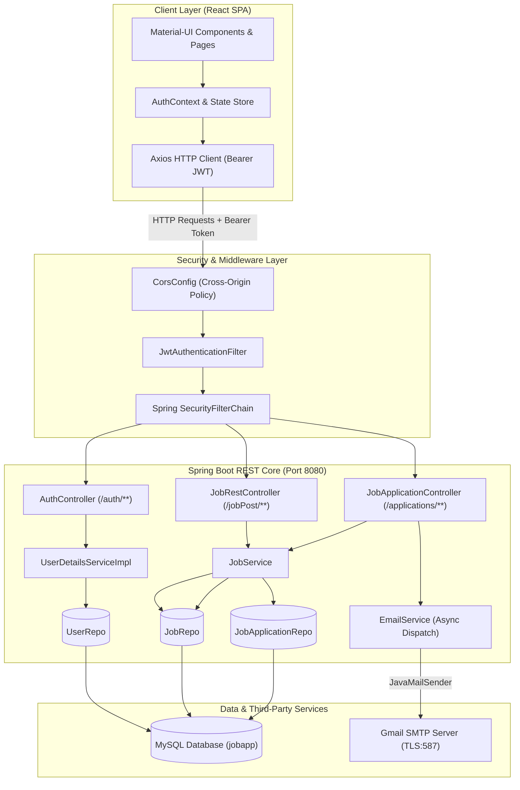
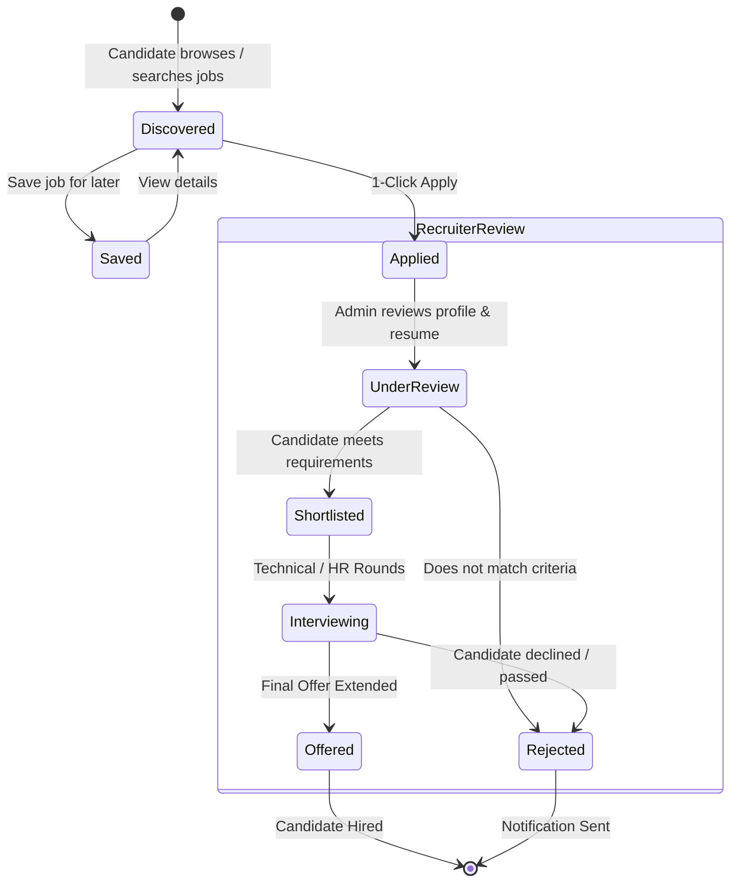
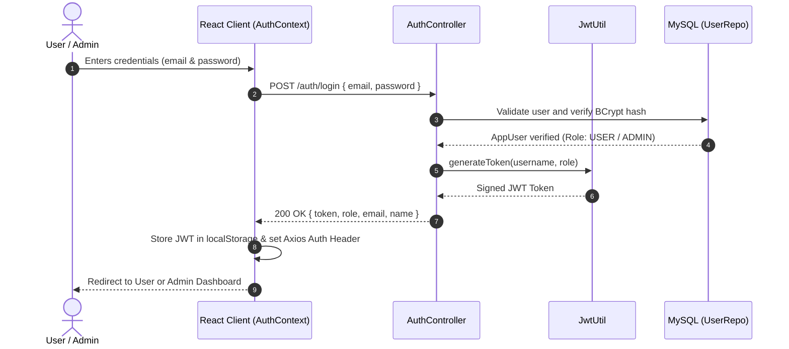
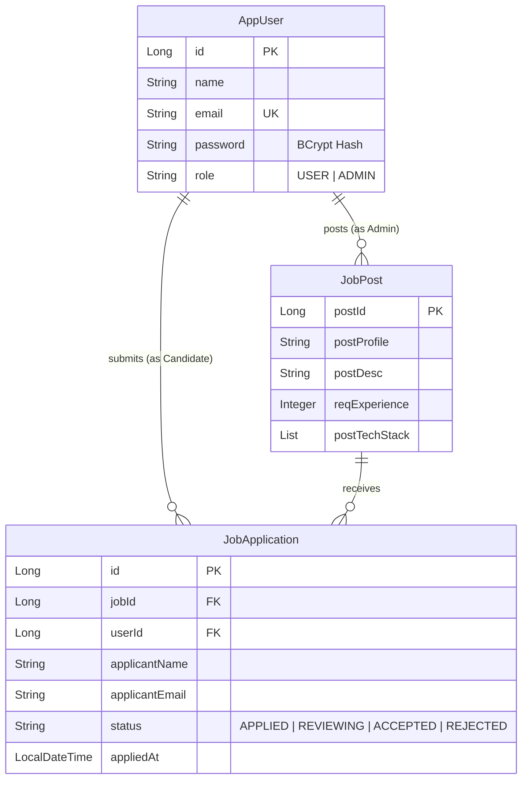

<div align="center">

# ⚡ JobSphere — Full-Stack Job Portal & Management System

<p align="center">
  <strong>An enterprise-grade hiring and career management platform bridging ambitious talent with modern companies.</strong>
</p>

[](https://spring.io/projects/spring-boot)
[](https://react.dev/)
[](https://openjdk.org/)
[](https://www.mysql.com/)
[](https://spring.io/projects/spring-security)
[](https://jwt.io/)
[](https://mui.com/)
[](LICENSE)

<br/>

[Overview](#-overview) •
[Core Features](#-core-features) •
[System Architecture](#-system-architecture) •
[Application Lifecycle](#-application-lifecycle-flow) •
[Tech Stack](#-technology-stack) •
[Database Model](#-database-schema--entity-relationships) •
[API Reference](#-rest-api-reference) •
[Getting Started](#-getting-started) •
[Default Credentials](#-default-test-accounts)

---

</div>

## 📌 Overview

**JobSphere** is a production-style, full-stack recruitment platform engineered to simplify hiring workflows. Built on a resilient **Spring Boot 3.2** RESTful backend running on **Java 21** and paired with a high-performance **React 18** client, JobSphere handles the entire hiring journey—from job posting and candidate discovery to application tracking and automated email updates.

---

## 🚀 Core Features

<table>
<tr>
<td width="50%" valign="top">

### 👨‍💻 Candidate Experience
* **🎯 Smart Job Discovery:** Real-time search across roles, technologies, experience levels, and locations.
* **⚡ 1-Click Application:** Seamless application submission with profile synchronization.
* **💾 Job Bookmarking:** Save listings to a personal drawer for later review and application.
* **📊 Visual Kanban Pipeline:** Track application status in real time (*Applied*, *In Review*, *Shortlisted*, *Interview*, *Offered*, *Rejected*).
* **📬 Instant Email Alerts:** Automated dispatch of application receipts directly to the applicant's inbox.
* **📚 Career Resources:** Integrated hub featuring interview guides, resume checklists, and career tips.

</td>
<td width="50%" valign="top">

### 💼 Recruiter & Admin Management
* **🧙 Multi-Step Job Wizard:** 4-step guided creation flow (Role Info ➔ Tech Stack & Skills ➔ Compensation ➔ Review).
* **✏️ Full Job CRUD:** Publish new postings, edit existing requirements, or remove outdated listings.
* **📋 Applicant Tracking System (ATS):** Review applicant rosters per job posting with full profile details.
* **🔄 Application Stage Pipeline:** Move candidates between evaluation stages with instant state updates.
* **🛡️ Role-Based Access Control (RBAC):** Route-level and API-level guardrails powered by Spring Security & JWT.
* **🌱 Auto Data Seeding:** Ready-to-test mock jobs and administrative accounts initialized on boot.

</td>
</tr>
</table>

---

## 🏛️ System Architecture



---

## 🔄 Application Lifecycle Flow

Candidates and recruiters interact with an intuitive state transition pipeline:



---

## 🔒 Authentication & Token Security Flow



---

## 🛠️ Technology Stack

<div align="center">

| Domain | Technology | Description |
| :--- | :--- | :--- |
| **Backend Core** | **Java 21** | Modern LTS release leveraging pattern matching and records |
| **Framework** | **Spring Boot 3.2.12** | Enterprise micro-framework with auto-configuration |
| **Security** | **Spring Security 6 + JWT** | Stateless authentication with custom filter chain & BCrypt |
| **ORM / Persistence** | **Spring Data JPA / Hibernate** | Type-safe repository abstraction with automatic DDL updates |
| **Database** | **MySQL 8.0+** | Relational data store for users, listings, and applications |
| **Mail Services** | **Spring Boot Starter Mail** | Asynchronous email notifications over SMTP TLS |
| **Frontend Core** | **React 18.2** | Concurrent mode rendering with functional components & hooks |
| **UI Framework** | **Material-UI (MUI 5.15)** | Modern design system, responsive grid & iconography |
| **State & HTTP** | **Context API + Axios** | Centralized auth state & bearer token interceptors |
| **Build & Tooling** | **Maven Wrapper (`mvnw`) + npm** | Cross-platform repeatable builds without pre-installed tools |

</div>

---

## 🗄️ Database Schema & Entity Relationships

The data model connects users, job postings, and submitted applications:



---

## 📡 REST API Reference

### 🔑 Authentication Module
| Method | Endpoint | Access | Description |
| :---: | :--- | :---: | :--- |
| `POST` | `/auth/register` | `Public` | Register a new account (`USER` or `ADMIN`) |
| `POST` | `/auth/login` | `Public` | Validate credentials and receive signed JWT |

### 💼 Job Postings Module
| Method | Endpoint | Access | Description |
| :---: | :--- | :---: | :--- |
| `GET` | `/jobPosts` | `Public` | Fetch all available job postings |
| `GET` | `/jobPost/{postId}` | `Public` | Retrieve single job post details |
| `GET` | `/jobPosts/keyword/{keyword}` | `Public` | Search jobs by skill, role, or keyword |
| `POST` | `/jobPost` | `ADMIN` | Create a new job post listing |
| `PUT` | `/jobPost` | `ADMIN` | Update an existing job post |
| `DELETE` | `/jobPost/{postId}` | `ADMIN` | Delete a job posting |

### 📝 Applications & Tracking Module
| Method | Endpoint | Access | Description |
| :---: | :--- | :---: | :--- |
| `POST` | `/jobPost/{postId}/apply` | `USER` | Submit job application with candidate profile |
| `GET` | `/applications` | `ADMIN` | Retrieve all applications across all jobs |
| `GET` | `/applications/job/{jobId}` | `ADMIN` | Retrieve applications for a specific job |
| `GET` | `/applications/user/{userId}` | `USER` / `ADMIN` | View application history for a candidate |
| `PUT` | `/applications/{id}/status` | `ADMIN` | Transition candidate status in pipeline |

---

## ⚡ Getting Started

### 📋 Prerequisites
Ensure the following tools are installed on your machine:
* **JDK 21** (`java -version`)
* **Node.js 18+ & npm 9+** (`node -v` & `npm -v`)
* **MySQL Server 8.0+** (`mysql -u root -p`)
* **Git** (`git --version`)

---

### 1️⃣ Clone the Repository
```bash
git clone https://github.com/Chandan9153/job_portal.git
cd job_portal
```

---

### 2️⃣ Database Configuration
Create a dedicated MySQL database:
```sql
CREATE DATABASE jobapp;
```

Update your connection credentials in:
`Backend-SpringBoot/src/main/resources/application.properties`
```properties
spring.datasource.url=jdbc:mysql://${DB_HOST:localhost}:${DB_PORT:3306}/${DB_NAME:jobapp}?useSSL=false&allowPublicKeyRetrieval=true
spring.datasource.username=${DB_USERNAME:root}
spring.datasource.password=${DB_PASSWORD:your_password}
```

---

### 3️⃣ Backend Setup (Spring Boot)
Open a terminal in the root directory:
```bash
cd Backend-SpringBoot

# Build and package the backend
mvn clean install

# Launch the application
./mvnw spring-boot:run
```
> The Spring Boot backend starts at: **`http://localhost:8080`**  
> *Sample jobs and default test users will be seeded automatically on startup.*

---

### 4️⃣ Frontend Setup (React)
Open a separate terminal window:
```bash
cd Frontend-React

# Install project dependencies
npm install

# Start the React development server
npm start
```
> The React web client will open automatically at: **`http://localhost:3000`**

---

## 👥 Default Test Accounts

For immediate evaluation, the following pre-configured credentials are ready to use:

| Role | Email Address | Password | Permissions |
| :--- | :--- | :--- | :--- |
| **Admin / Recruiter** | `admin@jobapp.com` | `admin123` | Full access to create, edit, delete jobs & review candidates |
| **Job Seeker / Candidate** | `user@jobapp.com` | `user123` | Browse jobs, save listings, apply & track application pipeline |

---

## ⚙️ Configuration & Environment Variables

| Variable | Default Value | Description |
| :--- | :--- | :--- |
| `DB_HOST` | `localhost` | MySQL database host |
| `DB_PORT` | `3306` | MySQL port |
| `DB_NAME` | `jobapp` | Target database schema |
| `DB_USERNAME` | `root` | Database username |
| `DB_PASSWORD` | `Alok#123` | Database password |
| `JWT_SECRET` | `mySecretKey...` | HMAC-SHA secret for token signing |
| `JWT_EXPIRATION`| `86400000` | Token expiration time (24 hours in ms) |
| `MAIL_HOST` | `smtp.gmail.com` | SMTP host for email dispatch |
| `MAIL_PORT` | `587` | SMTP port (TLS) |
| `MAIL_USERNAME` | `your_email@gmail.com` | Sender email account |
| `MAIL_PASSWORD` | `your_app_password` | Gmail 16-character App Password |

---

## 📂 Project Directory Structure

```plaintext
job-portal-and-management-system/
├── Backend-SpringBoot/                  # Java 21 & Spring Boot 3.2 Core
│   ├── src/
│   │   ├── main/
│   │   │   ├── java/com/alok/jobApplication/
│   │   │   │   ├── config/              # SecurityConfig & CorsConfig
│   │   │   │   ├── controller/          # REST Controllers (Auth, Job, Application)
│   │   │   │   ├── enums/               # Role & ApplicationStatus Enums
│   │   │   │   ├── filter/              # JwtAuthenticationFilter
│   │   │   │   ├── model/               # JPA Entities (AppUser, JobPost, JobApplication)
│   │   │   │   ├── repo/                # Spring Data JPA Repositories
│   │   │   │   ├── service/             # Business Logic & EmailService
│   │   │   │   └── util/                # JwtUtil token issuance & validation
│   │   │   └── resources/
│   │   │       └── application.properties # Spring Boot configuration
│   │   └── test/                        # Backend unit & integration tests
│   ├── mvnw & mvnw.cmd                  # Maven wrappers
│   └── pom.xml                          # Project dependencies & build config
│
├── Frontend-React/                      # React 18 Single Page Application
│   ├── public/                          # Static assets & index.html
│   ├── src/
│   │   ├── components/                  # Navbar, Hero, Kanban, Modals, Job Cards
│   │   ├── context/                     # AuthContext (JWT authentication state)
│   │   ├── utils/                       # Axios client & sample datasets
│   │   ├── App.js                       # Route definitions & layout wrapping
│   │   ├── App.css & index.css          # Design system, styling & utilities
│   │   └── index.js                     # React DOM entrypoint
│   └── package.json                     # NPM packages & run scripts
│
├── .gitignore                           # Git ignore rules for build artifacts
└── README.md                            # Comprehensive project documentation
```

---

## 🤝 Contributing

Contributions, feedback, and feature suggestions are welcome!

1. **Fork** the repository
2. **Create** your feature branch: `git checkout -b feature/NewFeature`
3. **Commit** your changes: `git commit -m 'Add NewFeature'`
4. **Push** to the branch: `git push origin feature/NewFeature`
5. **Open** a Pull Request

---

## 📄 License

This project is licensed under the [MIT License](LICENSE).

---

## 👤 Author & Acknowledgements

**Chandan Kumar**

* GitHub: [@Chandan9153](https://github.com/Chandan9153)
* Repository: [https://github.com/Chandan9153/job_portal](https://github.com/Chandan9153/job_portal)

<div align="center">
  <sub>Engineered with precision using Spring Boot 3 & React 18</sub>
</div>
